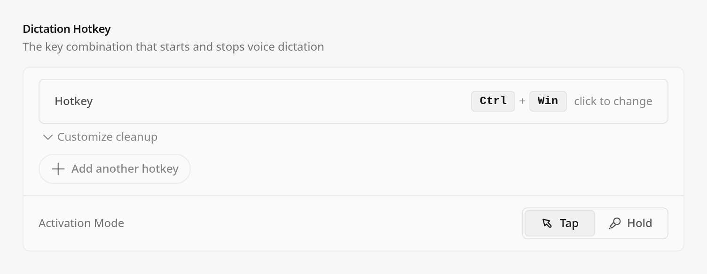
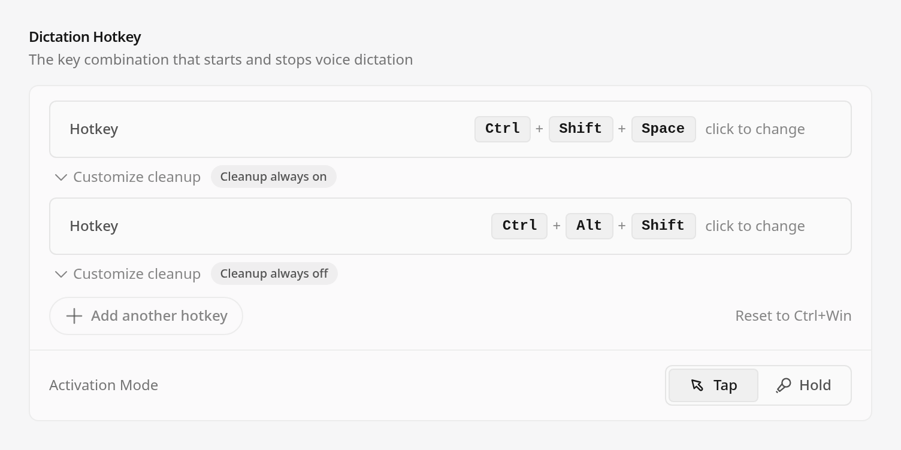
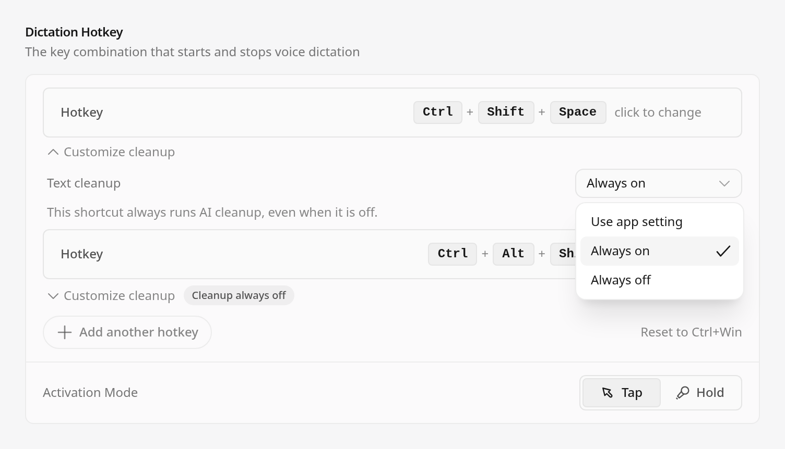

# Per-shortcut cleanup screenshots

Captured on October 22, 2026 from application commit
`23cff499d1b6c349dc5d7b60ebc25e70a6c467fb`.

These are real SettingsPage components rendered in headless Chrome 144 through
the application's Vite configuration, with synthetic settings, stubbed Electron
IPC and a Windows (`win32`) platform fixture. They are not generated mockups,
native Windows screenshots or evidence of a running Electron application.

The app's Noto Sans font was loaded and verified before capture. The open menu
was opened by clicking its real trigger. The final capture completed with exit
0 and without browser or cleanup errors.

## Default setup



## Two shortcuts



## Cleanup choices



## Provenance

The sibling `SHA256SUMS.txt` verifies the three PNGs with `sha256sum -c SHA256SUMS.txt`.
The capture harness SHA-256 is `4c191f33edf1c037708d24164f4081d1b28f05ff1799044782b9470c89f6b991`.
Rendered source hashes match the immutable application commit above:

```text
SOURCE src/components/SettingsPage.tsx a673c4401713dc29541540d004e13f67de4f526af4f0844133c6fe5672c00504
SOURCE src/components/settings/DictationCleanupControl.tsx 20b82e4000560bd6747fe0fddc6d4e516f68bec878c8def97bca61d49cf79e0b
SOURCE src/components/ui/HotkeyListInput.tsx e58397d33c9cca483395ba7662bd99664f7f932dd5582f81fe6971cbe3a72191
SOURCE src/components/ui/HotkeyInput.tsx c688e4fb84460059fe70135678cdbd80355569a20e6d613068da62931b294aa8
SOURCE src/stores/settingsStore.ts 8fd23f65134064a7063ce7502a4630bc5a8cb46a3df822a21f6862906204a886
```

Windows manual acceptance belongs to the earlier feature commit `4faeb677`
([test build](https://github.com/BTripp1986/openwhispr/actions/runs/39711069324/artifacts/12397908844)),
not to these component captures or the integrated commit.
