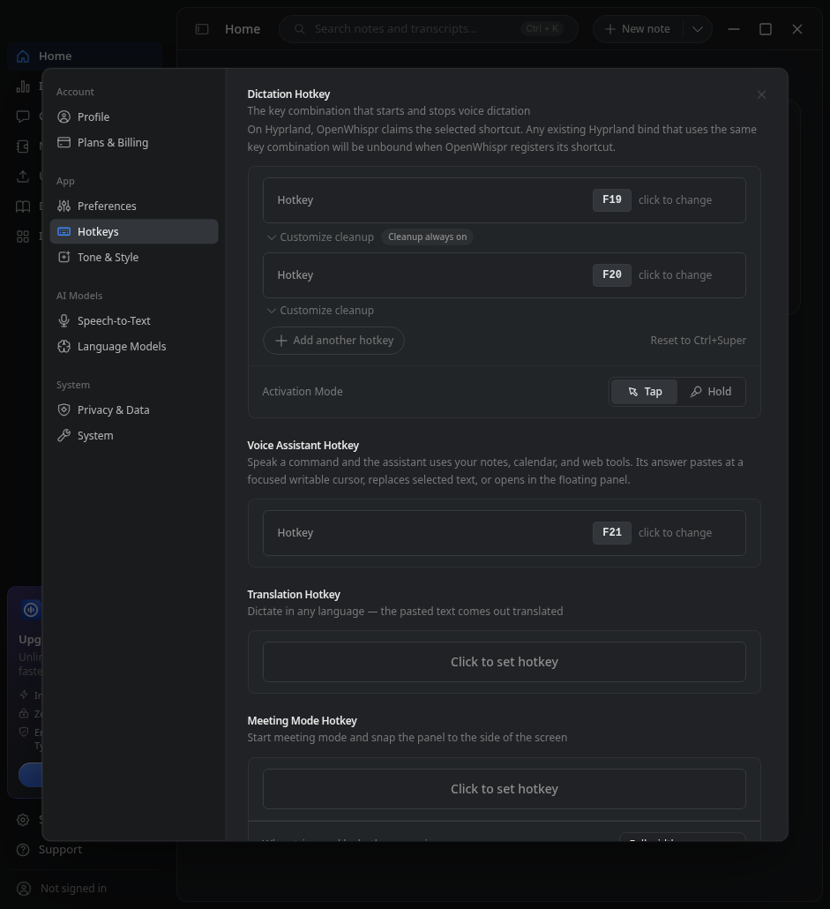
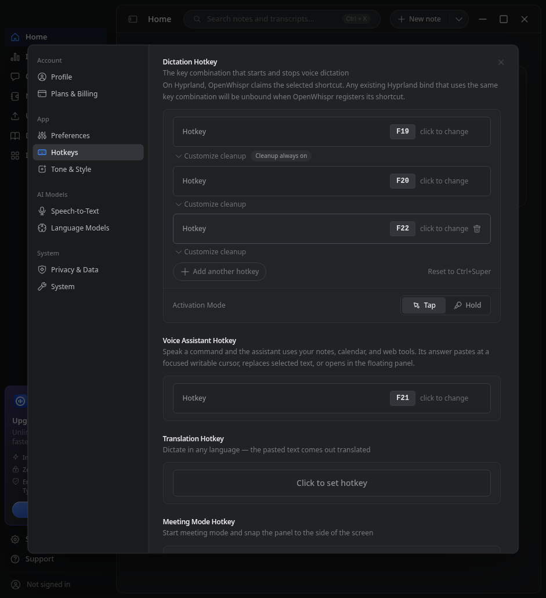

# Additional native validation, October 24

Application candidate: `23cff499d1b6c349dc5d7b60ebc25e70a6c467fb`. The application source is unchanged. This evidence does not replace the earlier physical Windows acceptance at `4faeb677` or the original component screenshots.

## Open defect: Hyprland startup restores only the first binding

On Omarchy / Hyprland 0.56.2, the real Electron app restores both saved dictation rows in Settings but registers only the first with the compositor. **This is unfixed at the candidate above.**

Reproduction with synthetic settings:

1. Save F19 as Always on and F20 as Use app setting.
2. Quit the app and start it again with the same isolated profile.
3. Wait 30 seconds and inspect the real compositor bindings. F19 is registered; F20 is absent. Both rows still appear in Settings and the saved configuration.
4. Add F22 through Settings. That hotkey-list commit registers F19, F20 and F22. Changing only a cleanup mode does not repair the missing binding.

The recorded reproduction has 11 passing assertions and 2 failing binding assertions, driver exit 1. [Selected raw results](hyprland-restart-results.json) separate stored rows from live bindings. F19 was first observed at 3,316 ms; F20 was not observed during the 30-second wait. Physical key presses were not tested, so failure to activate F20 is the expected consequence of its missing binding, not a claimed keypress result.

The startup path in `src/helpers/hotkeyManager.js:1360` calls `getSavedDictationHotkey()`, which selects only the first key, then the single-key `registerKeybinding` method. A later hotkey-list commit uses the multi-row path. GNOME/KDE have analogous source paths but were not tested on those desktops.

These screenshots contain synthetic settings and only the test app, not the user's desktop. They establish the visible settings, not the compositor bindings; the JSON records those separately.

## Verified coverage

| Check | Result and scope |
|---|---|
| [Windows x64 Electron](https://github.com/BTripp1986/openwhispr/actions/runs/40103355650) | 20/20 harness checks, driver exit 0. Real main/preload/renderer and Electron SQLite; four key/mode rows, saved spelling, invalid-key refusal and stored rows after restart. Driven through preload IPC, not Settings UI or OS keypresses. |
| [macOS arm64 and Intel Electron](https://github.com/BTripp1986/openwhispr/actions/runs/40102783079) | 18/18 checks on each Mac architecture, driver exits 0. Same IPC scope. The overall run failed because Windows version-output formatting failed before launch; the Windows-only run above fixes that harness failure. |
| [macOS arm64 native full suite](https://github.com/BTripp1986/openwhispr/actions/runs/40101084868/job/120893187919) | 8,926 total = 8,888 passed + 37 skipped + 1 todo; 0 failures/cancellations, suite exit 0. Node 24.20.0 / macOS 15.7.9. Platform-specific skips remain; this does not run Linux compositor tests on macOS. |
| [FFmpeg synthetic fixtures, macOS arm64 and Linux x64](https://github.com/BTripp1986/openwhispr/actions/runs/40104170959) | 7/7 on each platform, 0 skipped, suite exits 0. Transcoding and segment merging with the app-resolved FFmpeg. No audio device or provider call. Small full logs are included here. |
| Omarchy real Electron Settings | Row creation, adding a row, all three cleanup choices, exact IPC/.env/localStorage values, explicit global cleanup false/true without changing row modes, duplicate refusal, reset, and stored/UI state after restart were exercised. Live binding restoration after restart fails as described above. |

Electron was 41.10.7 with SQLite rebuilt for Electron ABI 145. Native Node SQLite was checked separately under Node ABI 137. Ignoring install scripts was not treated as proof that all native dependencies work. The smoke checks do not cover a complete packaged application or local speech/model binaries.

The Windows full native suite finished with **45 failures**: 8,922 total, 8,806 passed, 70 skipped, 1 todo, suite exit 1. Some failures involve tests extracting source with LF-only delimiters from a CRLF checkout; classification and a targeted Windows follow-up are in progress. No full-suite Windows pass is claimed. The Intel Mac full suite was still running at this checkpoint. Already-passing suites were not repeated. Test-only workflows use standard public GitHub runners and seven-day log retention, with no release/deploy steps.

## Boundaries and cleanup

- Hosted restart checks verify stored rows, not every live backend binding. Global cleanup was null before/after in hosted smoke; explicit false/true was checked in the Omarchy UI.
- No new physical microphone, real provider, OS keyboard activation, macOS Globe/Fn/TCC or GNOME/KDE acceptance. The earlier Omarchy 17/17 backend/D-Bus checks remain separate from this full-Electron UI run. Tap/Hold execution and owning-row stability are not established by capability flags.
- macOS native helper compilation is not blanket functional acceptance. Some probes were inconclusive because of their arguments; the microphone helper only enumerated a virtual device.
- Omarchy's test profile and Hyprland config were isolated without changing HOME. The app's CLI bridge nevertheless creates a home-directory token file; only metadata was inspected, never its contents. The app removes its token on quit, and the proven test-created empty directory was removed.
- The restart reproduction exited through app.quit with code 0. Full compositor bindings returned to the baseline; user Hyprland configuration was unchanged; no tracked test processes or D-Bus service remained. Earlier setup runs had harness/navigation/port-cleanup failures and are not counted as feature passes.
- Mac smoke quit with code 0; Windows smoke used SIGTERM. Windows debugger ports rebound and its Electron-path process snapshot was empty. Those hosted cleanup checks are narrower than an exhaustive native descendant audit.

[Electron check inventory](electron-checks.json) records independently counted assertions. The complete local evidence retains failed attempts; this public directory contains only concise synthetic evidence. No application fix, merge or release was performed.
