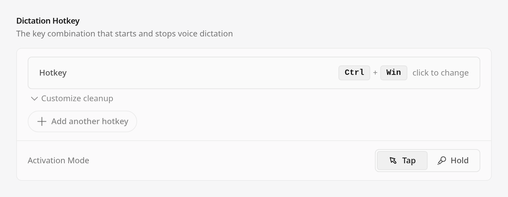
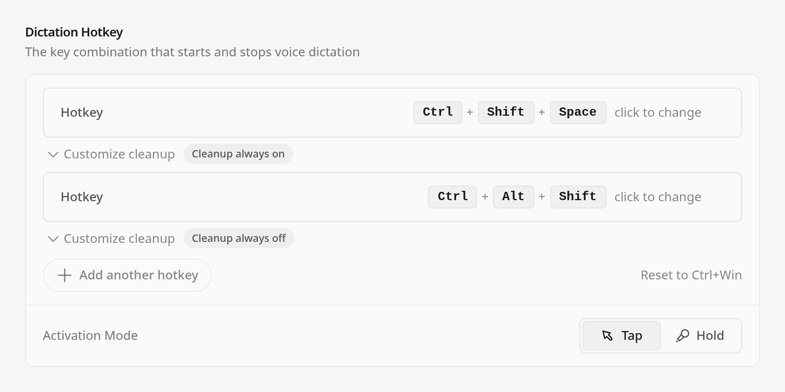
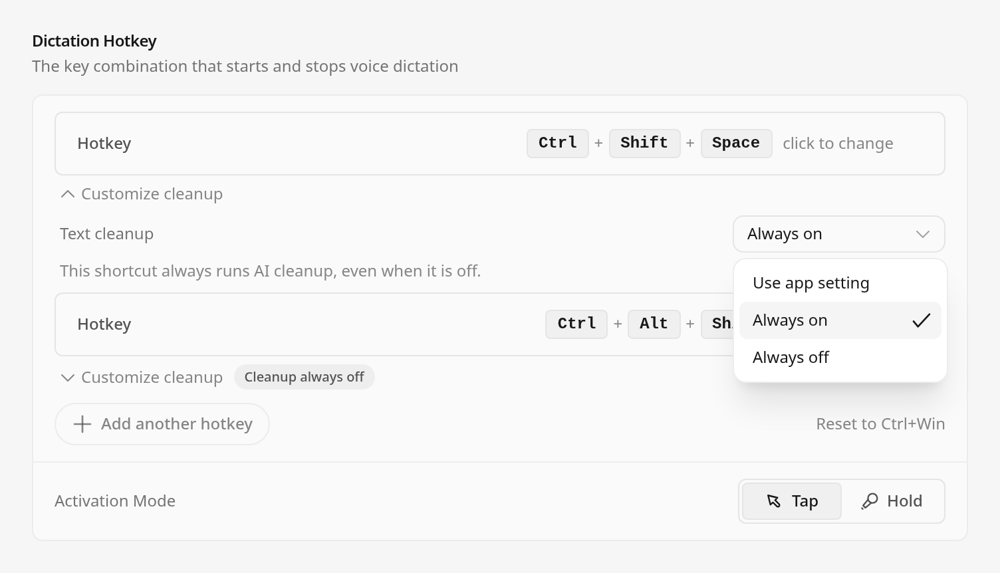

# PR #2912 — November 7 upstream update

Application commit: [`9a804d10253573428aee95610a28a2ac7ba37384`](https://github.com/BTripp1986/openwhispr/commit/9a804d10253573428aee95610a28a2ac7ba37384). Normal merge of upstream `cb08c411dd008c57e4f0a8193756d6b5812479fd` into published feature head `23cff499d1b6c349dc5d7b60ebc25e70a6c467fb`; no history rewrite. Resolves 14 conflict files across 334 upstream commits.

## Validation

Node 24.21.0; dependencies installed with `npm ci --ignore-scripts`; native `better-sqlite3` rebuilt and opened successfully. Lint (existing upstream warnings), full source formatting, feature-file formatting, typecheck, i18n consistency, signed model-registry verification and renderer build all exited 0.

The first 124-file regression run reached its 900-second limit: **1,242 passed, 26 failed, 19 cancelled; exit 124**. This is incomplete, not a passing full suite. The 26 assertions were stale test-fixture contracts after the upstream update. Six fixture files were adapted without changing the application code, skipping tests or relaxing timing assertions. The separate 23-file retry covers repaired and interrupted/unstarted files: **317 passed, 0 failed, 0 cancelled, 1 skipped; exit 0**. The skip is a Windows-only live loopback probe. Node's spec reporter counts 318 entries; its JUnit reporter counts 312 leaf testcases. [Per-file results](focused-run2-per-file.txt), [initial file list](focused-tests.txt), [retry file list](run2-files.txt).

Tests that passed in the initial run and were unchanged were not repeated. This is not a claim that the entire repository suite or every platform was rerun. Historical Windows/macOS results and the known Hyprland cold-start secondary-binding defect remain as disclosed in the PR; this update does not fix or revalidate those gaps.

## Screenshots

Captured from a clean checkout of the exact application commit above. The harness renders real production SettingsPage/HotkeyListInput/DictationCleanupControl components in headless Chrome using synthetic settings, mocked Electron IPC and a Windows platform fixture. These are component captures, not native Windows, physical keyboard, microphone or provider acceptance tests. The real font asset was verified as loaded; seven UI scenarios completed with harness exit 0 and cleanup successful.

[Harness](render-dictation-ui-evidence.js) and [source hashes/capture log](ui-capture.log). No user data or credentials are used. Three views are embedded in the PR:

Additional scenarios show expanded customization, a changed mode, an unconfirmed commit and a refused commit. Visual inspection confirmed the three embedded views have readable labels and the open dropdown within the crop.

## PNG SHA-256

- `ui-1-default-collapsed.png`: `07082380e0b7838954cd94c01cf84f307206a60cc08a8de76ad7f5d813577e3f`
- `ui-2-two-rows-collapsed.png`: `01dbed5aae73fcfce66aa26141ae4eac29f3ff250076103d1f6e2d348340a1e0`
- `ui-3-customization-open.png`: `e10a0d48368a94a22e528fd26aec0d4cb230ffe678620904976141af58eb8bb3`
- `ui-4-selector-open.png`: `c714e113c0de84a38b59263ee269c7e3df6c28760ce71cfdd13f2e6bc048ea74`
- `ui-5-mode-chosen.png`: `488bd78f4684179ae45cab11c8de26dc329b386c05d0d5396aa4d1e797c24e22`
- `ui-6-commit-unconfirmed.png`: `7af8dee4f9a9f230e87f53b14f050166eb971fb1a0d364908d2895c5757b8c4d`
- `ui-7-commit-refused.png`: `3a72891bae4791cbb8928cb7d479e916810610a5a6ac2ffe8531f6e9a5a57616`
